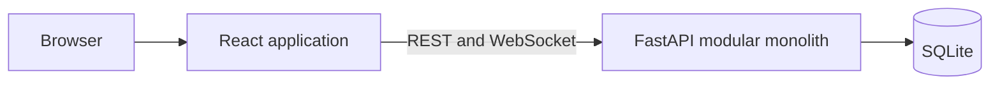

# SignSpeak
## Skill Without Barriers

**wHACKiest 2026 · Track 4 – UnlockED**

Deaf and hard-of-hearing learners can encounter communication barriers across vocational instruction, assessment and access to employment. SignSpeak is a foundation for accessible vocational learning, evidence-based assessment, verifiable credentials and job discovery. The intended journey is Learn → Practice → Assessment → Credential → Employment. Sign recognition is designed as an optional input method. Practical competency requires its own evidence and assessment.

### Phase 1

| Available | Future work |
| --- | --- |
| Responsive dashboard and route shells, live backend status and service capability reporting | Vocational content, progress and accessible competency assessments |
| Versioned REST endpoints and recognition handshake/heartbeat | CPU-based sign classification, optional speech and selected offline learning |
| SQLite lifecycle, developer diagnostics and automated checks | Credential issuance and verification, employment discovery |

React, TypeScript, Vite, Tailwind CSS and React Router run in the browser. FastAPI, Pydantic, SQLAlchemy, SQLite and Uvicorn form the backend. Tests use Pytest, Vitest, React Testing Library and Playwright.



### Run locally or in Codespaces

Install Python 3.12, Node 24 and npm. From the repository root run:

```bash
./scripts/setup
cp .env.example .env
./scripts/dev
```

Open `http://localhost:5173` or the Codespaces forwarded port 5173. The backend binds to loopback port 8000. For separate terminals run `./scripts/backend` and `npm --prefix frontend run dev`. See [setup](docs/development/SETUP.md) for production hosting requirements.

### Checks

```bash
backend/.venv/bin/ruff check backend
backend/.venv/bin/python -m pytest backend/tests
npm --prefix frontend run lint
npm --prefix frontend run typecheck
npm --prefix frontend test
npm --prefix frontend run build
(cd frontend && npx playwright install chromium)
npm --prefix frontend run test:e2e
```

### Structure

- `backend/` contains HTTP and WebSocket routing, configuration, Pydantic contracts, service capabilities, SQLite infrastructure and tests.
- `frontend/` contains the application, route views, data clients, shared UI, unit tests and browser tests.
- `backend/app/models/`, `ml/{collection,features,training,evaluation,inference,tests}`, `data/{raw,processed,manifests}` and `artifacts/{models,evaluation}` are reserved.
- `scripts/`, `.devcontainer/` and `.github/workflows/` provide development commands and CI.
- `docs/` holds [architecture](docs/architecture/SYSTEM_ARCHITECTURE.md), [protocol](docs/architecture/RECOGNITION_PROTOCOL.md), [ML design](docs/architecture/ML_PIPELINE_DESIGN.md), [database design](docs/architecture/DATABASE_DESIGN.md) and [validation](docs/validation/PHASE1_VALIDATION.md).

### Accessibility, privacy and roadmap

Phase 1 includes semantic landmarks, labelled controls, keyboard navigation and skip link, visible focus, text-based service announcements and reduced-motion styling. WCAG 2.2 AA informs the interface. Full conformance and assistive-technology compatibility require further testing with users.

Phase 1 has no account or camera capture, raw-media upload, model, predictions, credential issuance or job listings. Future data collection requires separate informed consent. The next implementation phase can establish consent and feature contracts before collecting data or validating classifiers. Later work covers learning and assessment evidence, credentials, employment, offline access and optional speech. See [originality and provenance](ORIGINALITY.md) and [contributing](docs/development/CONTRIBUTING.md).
