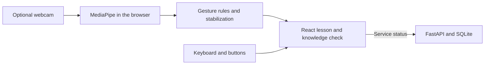

# SignSpeak
## Skill Without Barriers

**wHACKiest 2026 · Track 4 – UnlockED · First-round MVP**

Deaf and hard-of-hearing learners can face communication barriers in vocational education and assessment. SignSpeak demonstrates an accessible learning flow that pairs a short workplace-safety lesson with optional gesture controls and a three-question knowledge check. Each step also works through text, buttons and keyboard controls.

### What works

- The browser camera recognizes three static interface gestures from MediaPipe hand landmarks. Open palm, V sign and closed fist have a steady-hold filter and neutral state.
- **Workplace Safety Fundamentals** covers personal protective equipment, recognizing workplace hazards and emergency reporting. An open palm can advance the lesson.
- The assessment accepts gesture or radio-button selections. Learners explicitly confirm each answer, receive feedback and see a score and completion badge.
- The dashboard retains live backend availability. The lesson and knowledge check run in the browser and do not depend on the camera or backend.



### Install and run

Use Python 3.12, pip 22.3 or newer, Node.js 24 and npm. From the repository root run:

```bash
./scripts/setup
cp -n .env.example .env
./scripts/dev
```

Open `http://localhost:5173` or the HTTPS Codespaces forwarded port 5173. For separate terminals, use `./scripts/backend` and `npm --prefix frontend run dev`. Internet access is needed to fetch the Google hand-landmark model when starting the camera. Camera access requires localhost or HTTPS and browser permission.

### Demonstrate the MVP

1. From the dashboard choose **Try gesture camera**. Select **Start camera** and allow camera access.
2. In even light, frame one hand with all fingertips visible. Hold an open palm, then lower your hand until the label clears. Repeat with a V sign (index and middle fingers raised, ring and little fingers curled) and a closed fist. Try an unsupported shape and confirm the neutral label. Use **Stop camera** to release the webcam.
3. Choose **Open workplace safety lesson**. Use **Next section** or start the camera again and hold an open palm to advance. Lower your hand between advances. Read all three sections and choose **Start assessment**.
4. Select each answer with radio buttons or start the camera and use open palm for A, V sign for B, or closed fist for C. Choose **Confirm answer** with the button or keyboard, read the feedback, and advance.
5. After question three, choose **View score**. The badge records completion of the knowledge check. It carries no vocational accreditation and does not establish practical competency.

### Checks

```bash
backend/.venv/bin/ruff check backend
backend/.venv/bin/python -m pytest backend/tests
npm --prefix frontend run lint
npm --prefix frontend test
npm --prefix frontend run build
(cd frontend && npx playwright install chromium)
npm --prefix frontend run test:e2e
```

The browser tests start their own frontend and backend. Stop the development servers first. On Linux, Playwright may need system libraries. Use `npx playwright install --with-deps chromium` from `frontend/` if needed.

### Limitations and final hackathon proposals

The gesture controls support one visible hand and three static shapes. Position, lighting and occlusion affect detection. These gestures are generic interface controls and carry no claim of Indian Sign Language recognition. No recording, dataset preparation or custom model training is required. Camera frames stay on-device. Scores and badges are session-only. Meaningful verification before demo day includes physically trying the three gestures on the presentation laptop and checking its camera permissions and network access.

Potential final-hackathon work includes a validated sign vocabulary, additional vocational lessons, practical evidence assessment, verifiable credentials, employment discovery, offline access and optional speech. The original foundation and its [architecture notes](docs/architecture/SYSTEM_ARCHITECTURE.md) remain available. See [originality and provenance](ORIGINALITY.md) for the new dependency and model.
