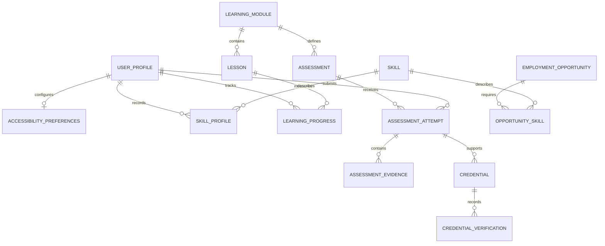

# Database design

Phase 1 opens and probes SQLite through SQLAlchemy. SQLite foreign-key enforcement is enabled on each connection. The app owns engine startup and disposal. There are no domain tables. `DeclarativeBase` gives future models one metadata registry. Add Alembic and a reviewed initial revision when the first entities arrive. Use migrations for schema changes and test upgrades on copies with foreign keys enabled.

Use unique learner/lesson progress rows, versioned assessments, immutable scoring evidence references, independently reviewed credential status and minimum disclosure in verification. Keep accessibility preferences private by default. Store future evidence outside the public web root and apply retention policies independently of the credential record. Employment opportunities and learner skill profiles can share a skill taxonomy without exposing preference data. Reassess SQLite concurrency using actual workloads.
