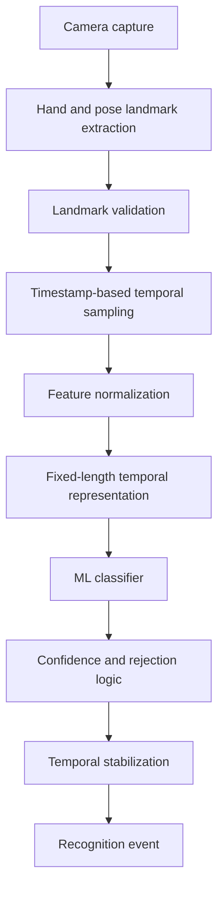

# ML pipeline design

The proposed design uses MediaPipe Tasks for local hand and pose landmarks where CPU and browser measurements permit. NumPy and scikit-learn are candidates for a CPU baseline, with Joblib reserved for trusted, verified artifacts. Phase 1 creates no training data, classifiers or weights.

## Proposed feature contract

Use a feature schema identifier independent of the transport version. Record layout, coordinate convention, selection of pose landmarks, handedness policy, masks, preprocessing parameters and extractor version in the model manifest. A temporal window contains ordered offsets, two stable left/right slots, pose anchors with visibility and validity masks. Keep missing detections explicit. Short gaps may be interpolated with a documented upper bound and masks. Long gaps invalidate the window. One-handed signs can have one inactive slot. Two-handed signs retain inter-hand position and motion.

Distinguish display mirroring from input mirroring, and canonicalize extraction coordinates before training or inference. Validate handedness with labelled examples, including crossings and partial visibility. Normalize translation and scale with stable body anchors where present, with an explicit fallback for incomplete pose. Preserve motion and relative hand geometry where they distinguish signs. Timestamp sampling handles variable camera cadence. Training and serving should share preprocessing code or use the same versioned fixtures across runtimes.

## Evaluation plan

Choose the supported language and vocabulary with signers and domain advisors. Separate signer groups before deriving overlapping windows. Include neutral movement, lookalike signs and out-of-vocabulary gestures. Compare compact statistical features and fixed windows on a CPU using class balance, latency, rejection, false activations and calibration. Compare short windows for responsiveness with longer windows for complete motion. Fit confidence and rejection thresholds on validation signers, then evaluate once on held-out signers. Set sampling rates, sequence lengths and thresholds only after these experiments. Suppress repeated predictions until a neutral interval or a stable class transition. Report trade-offs and per-signer variability before publishing performance claims.
