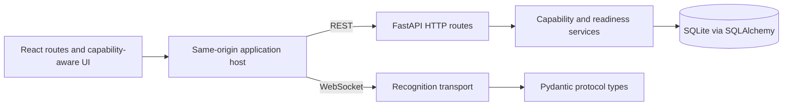
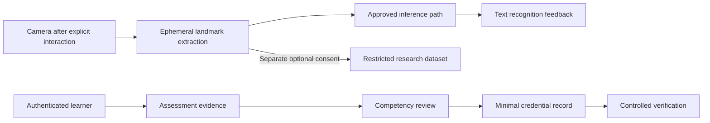

# System architecture

SignSpeak uses a React SPA and one FastAPI application. HTTP and WebSocket adapters share configuration and lifecycle. Capability declarations live in a service module. SQLite access sits behind its own boundary. A later model runner can be another module in the same process if CPU and latency measurements support it.

Vite provides a same-origin dev proxy. A production host supplies HTTPS, static files, SPA fallback and API/WebSocket forwarding. Database connection failure aborts startup. A later database probe failure reports degraded status. Recognition availability is independent of transport availability.

## Privacy and future data flow

Phase 1 has no sensors, personal data capture, analytics or secrets. Future recognition must minimize transmitted data, default to ephemeral processing and avoid automatic raw footage uploads. Treat landmarks as potentially identifying. No biometric identification or inference of disability or employability is permitted. For research, explain the exact fields, purpose, access, retention, withdrawal and deletion limits before recording. Refusal must leave the learning and assessment pathways usable. Keep research data isolated from operational records, apply access controls and set explicit deletion and audit policies before collection.

Explicit HTTP CORS origins and WebSocket origin checks are browser controls. Future accounts, credentials and evidence need authentication and authorization. Production hosting must use TLS and restrict direct backend access. Runtime logs should exclude payloads, secrets and personal data.
